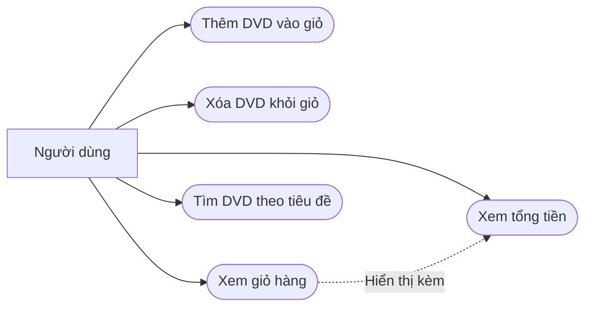

# Use case AIMS-mini — Lab 02

Tác nhân: người dùng quản lý một giỏ DVD bằng các lớp Python. `main.py` là chương trình minh họa; các chức năng dưới đây chưa phải menu tương tác.



| Use case | Thao tác và kết quả |
| --- | --- |
| Thêm DVD | Gọi `Cart.add_dvd(dvd)` để thêm DVD; kiểm tra giá trị trả về và thông báo. Giỏ có giới hạn `MAX_NUMBERS_ORDERED`. |
| Xóa DVD | Gọi `Cart.remove_dvd(dvd)`; DVD có trong giỏ sẽ bị xóa, nếu không có thì trả `False` và thông báo. |
| Xem giỏ | Gọi `Cart.print_cart()`; in số thứ tự, thông tin từng DVD và tổng tiền. Việc hiển thị không thay đổi danh sách DVD. |
| Giỏ trống | `Cart.print_cart()` in `The cart is empty` rồi kết thúc. |
| Tìm tiêu đề | Gọi `search_by_title(items, keyword)`; trả danh sách DVD chứa từ khóa trong tiêu đề. Lab 02 phân biệt hoa thường; không khớp thì trả `[]`. |
| Xem tổng tiền | Gọi `Cart.total_cost()`; cộng giá các DVD trong giỏ. Giỏ trống có tổng bằng 0. |

## Luồng minh họa

1. Tạo giỏ và ba DVD: The Lion King, Star Wars, Aladdin.
2. Thêm ba DVD rồi gọi `cart.print_cart()`.
3. Kết quả hiển thị ba DVD và tổng `63.89 $`.
4. Có thể tìm `Lion` trong `cart.items` để lấy The Lion King, hoặc xóa một DVD và xem lại giỏ.
5. Khi giỏ không còn DVD, chức năng xem giỏ thông báo giỏ trống.

## Kiểm tra

Chạy `python3 main.py` để xem giỏ mẫu. Kiểm tra giỏ trống bằng:

```bash
python3 -c 'from aims.cart import Cart; Cart().print_cart()'
```
